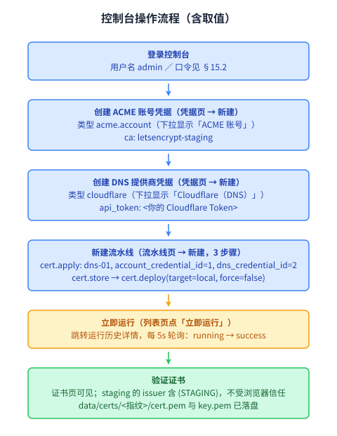

# 16. 控制台操作流程图

按 [11-frontend.md](11-frontend.md) 的页面能力，一次完整的「登录 → 建凭据 →
建流水线 → 运行 → 验证」操作链路如下。各步骤标注了本地开发场景下的典型取值
（staging 端点、Cloudflare DNS、本地部署），与 [15-local-development.md](15-local-development.md)
的 15.5 走通流程一致。

## 步骤说明

| 步骤 | 页面 | 关键取值 |
| --- | --- | --- |
| 1 登录 | `/login` | 用户名 `admin`，口令由 `ACMECAST_ADMIN_PASSWORD_HASH` 对应 |
| 2 建 ACME 账号凭据 | `/credentials` → 新建 | 类型 `acme.account`，`ca=letsencrypt-staging` |
| 3 建 DNS 凭据 | `/credentials` → 新建 | 类型 `cloudflare`，`api_token=<Token>` |
| 4 建流水线 | `/pipelines/new` | `cert.apply`(dns-01) → `cert.store` → `cert.deploy`(local) |
| 5 立即运行 | `/pipelines` → 立即运行 | 跳转 `/histories/:id`，每 5s 轮询至 `success` |
| 6 验证证书 | `/certificates` | 证书记录可见；`data/certs/<指纹>/cert.pem` 落盘 |

> 流水线编辑器里 `account_credential_id` / `dns_credential_id` 是按名称选择的下拉
> （值仍是数字 ID），`cert.deploy` 的 `config` 因结构随 `target` 变化而按 JSON 文本
> 编辑。详见 [11-frontend.md](11-frontend.md) 11.3。
